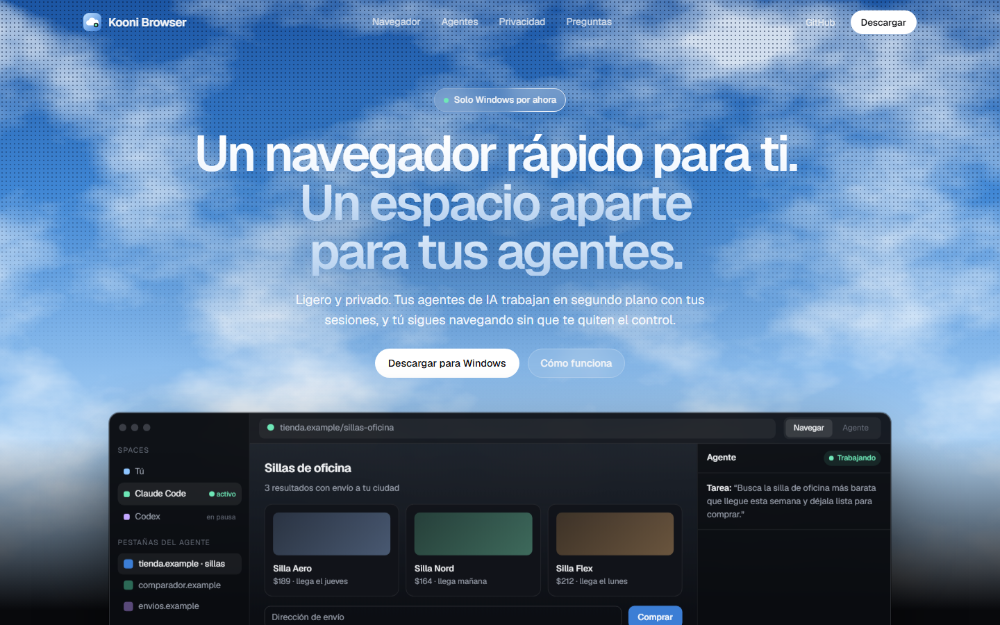
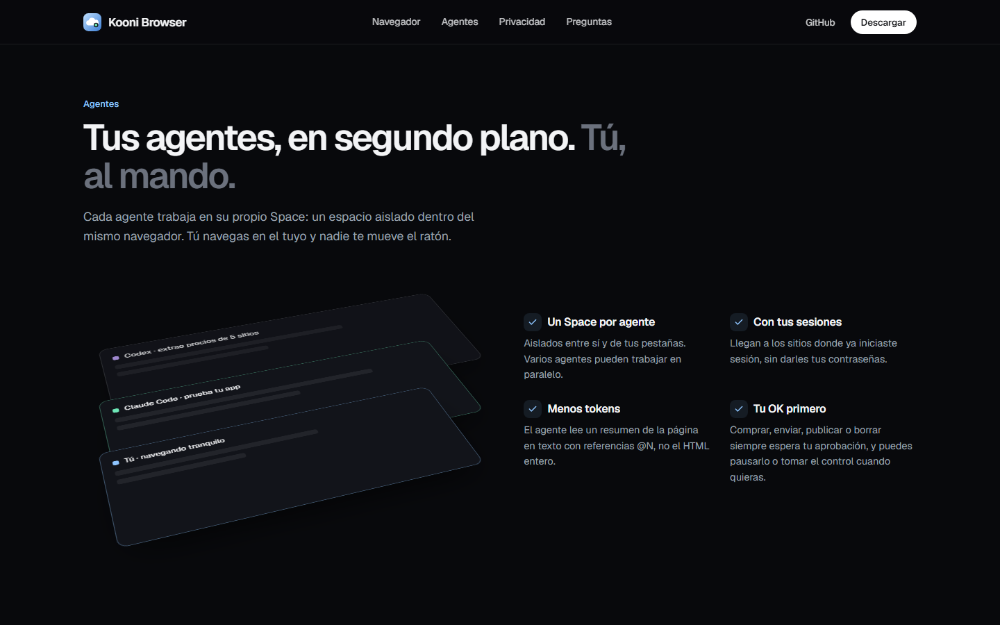
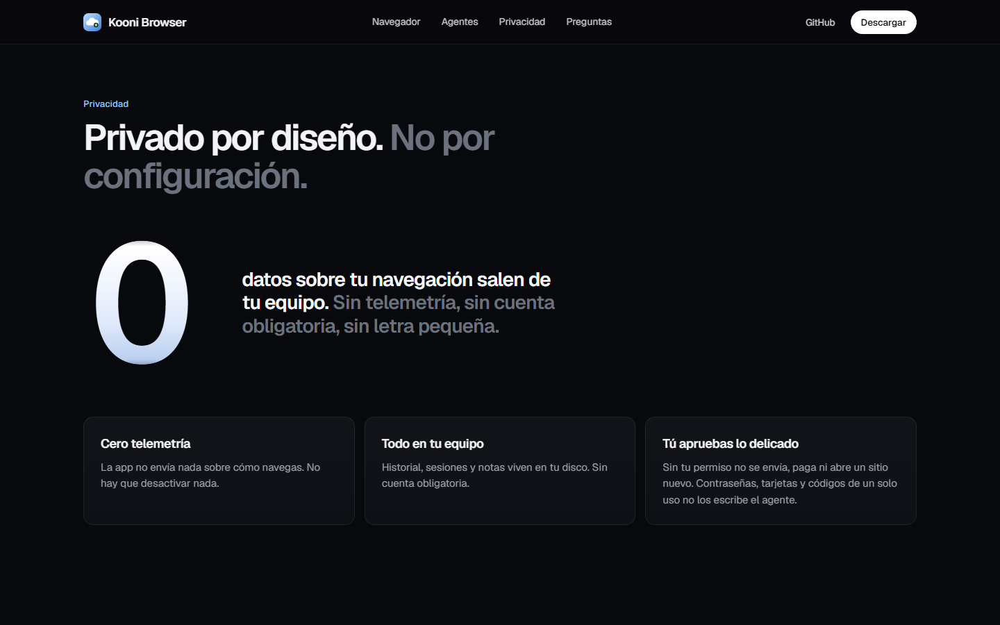

<div align="center">

# Kooni Browser

**Un navegador rápido para ti. Un espacio aparte para tus agentes de IA.**

Ligero y privado, para Windows. Tus agentes (Claude Code, Codex, Cursor…) trabajan en segundo plano, cada uno en su propio Space, y tú los ves trabajar y puedes tomar el control cuando quieras.

[**⬇ Descargar el instalador (Windows)**](https://github.com/iamnocodeveloper/kooni-browser/releases/latest) &nbsp;·&nbsp; [**Ver la web**](https://iamnocodeveloper.github.io/kooni-browser/)

`Versión preliminar 0.3.0` · `Windows 10 / 11` · `Gratis` · `Instalador de ~3 MB`



</div>

---

## Qué es

Un navegador normal, con **pestañas arriba**, Spaces, perfiles, carpetas de pestañas, vista dividida y pestañas dormidas, pensado para que un agente de IA pueda usar la web **sin pelearse contigo por el ratón**:

- **Un Space por agente, en paralelo.** Cada agente que se conecta recibe su propio Space. Tú sigues en el tuyo.
- **Míralo trabajar en vivo.** Con un clic ves la página del agente junto a la tuya, con un cursor que se mueve donde hace clic.
- **Tú al mando.** Pausa al agente, tómale el control y devuélvelo. Antes de comprar, enviar, publicar o abrir un sitio nuevo, se detiene y espera tu OK.
- **Con tus sesiones.** El agente entra a los sitios donde ya iniciaste sesión, pero nunca escribe en campos de contraseña, tarjeta o código de un solo uso.
- **Vista general.** Un botón abre fichas con la miniatura de la página de cada agente y de tus Spaces.
- **Acciones rápidas.** `Ctrl+K` (o escribir `>` en la dirección) para dividir la vista, crear Spaces, conectar un agente, pausar o tomar el control.

<table>
  <tr>
    <td></td>
    <td></td>
  </tr>
</table>

> Las animaciones de la web son una **maqueta ilustrativa**: la aplicación real tiene las pestañas arriba, no en una barra lateral.

## Instalar

1. Descarga `Kooni-Setup-0.3.0.exe` desde la [última versión](https://github.com/iamnocodeveloper/kooni-browser/releases/latest).
2. Ejecútalo. Se instala **solo para tu usuario**, sin pedir administrador, y se desinstala desde *Configuración → Aplicaciones*.
3. Si Windows muestra «SmartScreen» o «Control de aplicaciones»: es porque **el instalador todavía no está firmado digitalmente**. En SmartScreen: *Más información → Ejecutar de todas formas*. Si tienes «Control de aplicaciones inteligente» en modo estricto, puede bloquearlo.

Comprueba la descarga con su huella SHA-256 (está en la página de la versión).

Requiere el motor **WebView2 de Microsoft**, que ya viene con Windows 11 y con las versiones actuales de Windows 10.

## Conectar un agente

Con Kooni instalado, en una terminal (el comando exacto también aparece dentro de la app, en el botón ✦):

```
claude mcp add kooni -- "%LOCALAPPDATA%\Programs\Kooni\kooni.exe" mcp
```

Cada agente que se conecte recibe su propio Space la primera vez que actúa. Si Kooni está cerrado, el agente lo abre minimizado. Herramientas disponibles: `kooni_snapshot`, `kooni_click`, `kooni_type`, `kooni_key`, `kooni_scroll`, `kooni_navigate`, `kooni_screenshot`, `kooni_tabs`, `kooni_space_create`… (20 en total, servidor MCP estándar).

## Privacidad

- **Sin telemetría y sin cuenta.** Historial, sesiones y pestañas se guardan en tu equipo, en `%LOCALAPPDATA%\Kooni`.
- El control de los agentes funciona **dentro del proceso**: no abre ningún puerto de depuración. El puente local solo escucha en `127.0.0.1` con un token aleatorio.
- Todo lo que hace un agente queda anotado en un registro que puedes abrir desde el menú del perfil.

## Estado y límites (versión preliminar)

Es un proyecto joven. Antes de usarlo a diario, ten en cuenta que:

- Solo funciona en **Windows**. No hay versión para Mac ni Linux todavía.
- **No tiene** bloqueador de anuncios, extensiones, importación desde Chrome ni «buscar en la página».
- El instalador **no está firmado** (ver arriba).
- Está probado con agentes simulados; la conexión con Claude Code, Codex y Cursor reales aún se está validando.
- **El código fuente todavía no es público.**

## Inspiración

El diseño y el comportamiento se inspiran en [Zephium](https://github.com/zephium-browser/Zephium) (barra de pestañas, Spaces, perfiles, vista dividida) y en [Ego Lite](https://github.com/citrolabs/ego-lite) (un Space por agente, ver al agente y tomar el control). No se copió código de ninguno de los dos.

## Avisos de terceros

Usa el motor WebView2 de Microsoft. La tipografía es [Geist](https://vercel.com/font) (SIL Open Font License 1.1).

---

Hecho por **Nocodeveloper**.
